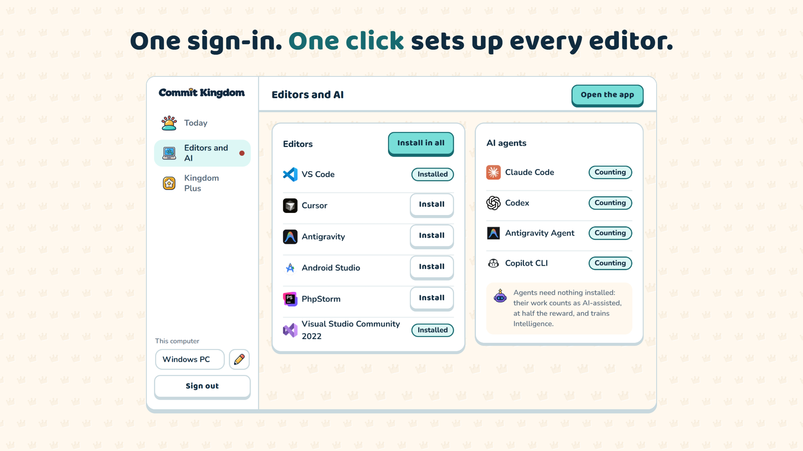
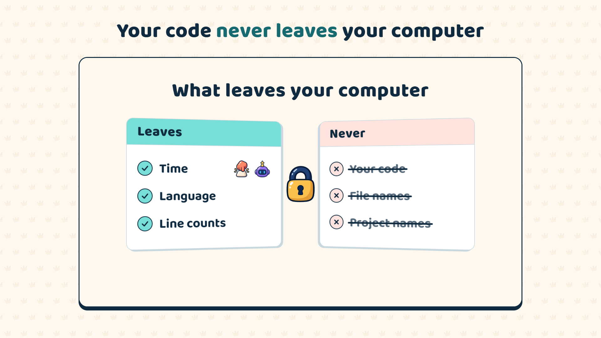

# Commit Kingdom Tracker for Visual Studio

Counts your coding in Visual Studio 2022 and later for [Commit Kingdom](https://commitkingdom.com), the strategy game where your commits build your kingdom.

## Getting started

1. Install [Commit Kingdom Desktop](https://commitkingdom.com/tracker) and sign in with your Commit Kingdom account.
2. Commit Kingdom Desktop finds Visual Studio and installs this extension with one click. You never sign in inside Visual Studio.
3. Restart Visual Studio and code.

## What is sent

Only when you code, in which language, how many lines changed and whether you were coding, building or debugging. File names, file paths and your real project names never leave your computer; a project is sent only as a salted one-way hash.

The tracker is open source: [poyrazavsever/commit-kingdom-tracker](https://github.com/poyrazavsever/commit-kingdom-tracker).
