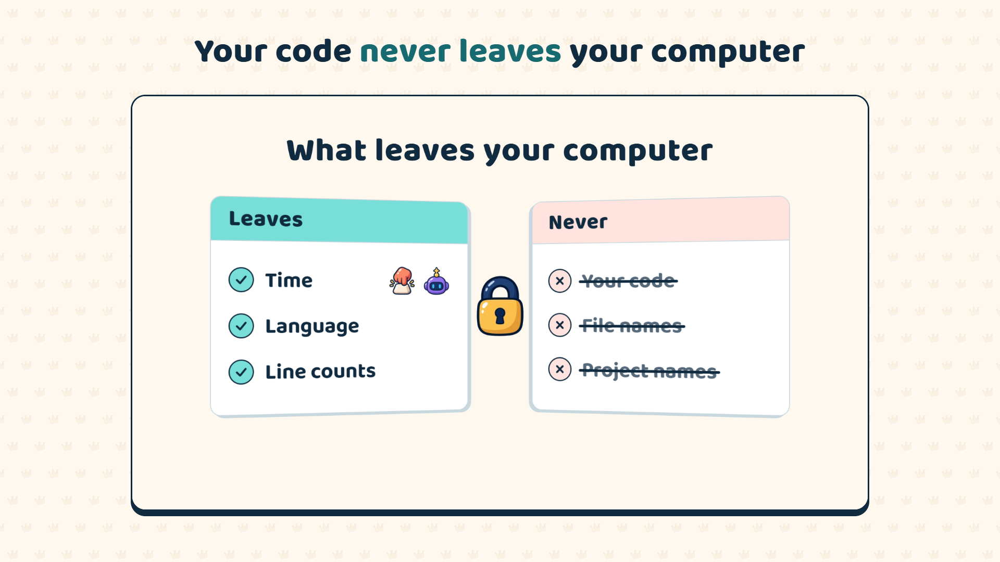

# Commit Kingdom Tracker

Counts your coding for [Commit Kingdom](https://commitkingdom.com), the strategy game where your commits build your kingdom. Every verified minute becomes energy for your kingdom: train troops, raid other towers, open chests.

Works in VS Code, Cursor, Windsurf, VSCodium and Antigravity.

## Getting started

1. Install [Commit Kingdom Desktop](https://commitkingdom.com/tracker) and sign in with your Commit Kingdom account.
2. Commit Kingdom Desktop installs this extension in every editor it finds, with one click. You never sign in inside the editor.
3. Code. Today's total shows in the status bar.

## What is sent

Only when you code, in which language, how many lines changed and how many of them an AI tool wrote. File names, file paths, branches, dependencies and your real project names never leave your computer; a project is sent only as a salted one-way hash that is different on every computer.

AI-assisted minutes count too, at half the reward. Work with Claude Code, Codex, Gemini CLI and other agents counts even without an editor open.

The tracker is open source: [poyrazavsever/commit-kingdom-tracker](https://github.com/poyrazavsever/commit-kingdom-tracker).
